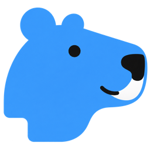

<p align="center">
  
</p>

<h1 align="center">Agenvas</h1>

<p align="center"><a href="README.md">English</a> | <a href="README.zh-CN.md">简体中文</a> | <strong>日本語</strong> | <a href="README.ru.md">Русский</a></p>

<p align="center"><strong>セルフホスト型 AI クリエイティブキャンバス</strong><br />テキスト、画像、動画、音声、Agent をひとつのワークスペースに。</p>

<p align="center">Agenvas は、高額なサブスクリプションや最上位モデルに縛られず、個人でも低コストで創作キャンバスを使い、手頃な選択肢を自分で選べる環境を目指しています。</p>

<p align="center">
  <a href="#クイックスタート">クイックスタート</a> ·
  <a href="#対応する連携先">連携先</a> ·
  <a href="#デプロイとメンテナンス">デプロイ</a> ·
  <a href="#ローカル開発">ローカル開発</a> ·
  <a href="#フィードバックと貢献">フィードバックと貢献</a> ·
  <a href="LICENSE">MIT</a>
</p>

<p align="center">作者：<a href="https://x.com/Grayrepo">X / Twitter @Grayrepo</a> · メール：<a href="mailto:yoshioka8084806@gmail.com">yoshioka8084806@gmail.com</a></p>

<p align="center">
  <br />
  スキャンして WeChat 公式アカウントをフォロー
</p>

> 現在は、管理者ひとりでセルフホストするための開発版です。今後のバージョンとのデータ互換性は保証されません。

## 機能

| 機能 | 説明 |
| --- | --- |
| キャンバスでの創作 | ドラッグ、範囲選択、接続、自動整列、グループの命名・折りたたみ、ノード単体・グループ全体の複製、同一セッション内の表示編集の元に戻す・やり直し、ローカルメディアのアップロード |
| マルチモーダル生成 | テキスト・画像・動画・音声をカードごとに実行。キュー、キャンセル、再生成、バージョン履歴に対応 |
| Agent との共同作業 | 右下のディレクターチャットが必要に応じて現在のキャンバスを読み取り、操作。会話の永続化と Skill に対応し、メディア生成の提案はユーザー承認後に実行 |
| MCP 接続 | 内蔵ディレクターを維持しつつ、ユーザートークンで外部クライアントに 13 個の創作ツール（インテリジェントなナレーション合成を含む）を公開。許可済みのメディア呼び出しは、呼び出しごとの課金承認なしで受け付け |
| 素材の再利用 | プロジェクト素材、個人アセットライブラリ、プロンプトテンプレート、メディアスタイル、複数形式を組み合わせた参照入力 |
| キャラクターの一貫性 | プロジェクトのキャラクター、複数の外見、画像・音声参照。プレビュー後にショットの下書きへ適用し、変更の影響を追跡して結果を個別に確認 |
| 画像処理 | 注釈、切り抜き、回転、反転、拡大、深度抽出、および設定済みの機能による AI 編集 |
| セルフホスト管理 | モデル設定、ローカルおよび OSS/COS/S3 ストレージ、タスクと呼び出し記録、プロジェクトマニフェストのエクスポート |

UI は中国語、英語、ロシア語、日本語に対応しています。

## 対応する連携先

以下は Agenvas に実装されている連携先です。利用可能なモデル、パラメーター、入力制限は、管理者が公開した機能と利用するプロバイダーのアカウントによって異なります。

### モデルとワークフロー

| プロバイダー / プラットフォーム | モデル / 連携方式 | 利用可能な機能 |
| --- | --- | --- |
| OpenAI 互換エンドポイント | Chat Completions API | テキスト生成、ディレクターチャット、ツール呼び出し |
| OpenAI | GPT Image 2 / Images API | 画像生成、参照画像を使った編集、マスク、透明背景 |
| Google | Nano Banana 2 / Gemini Flash Image | 画像生成と参照画像を使った編集 |
| Google | Veo 3.1 / Gemini Omni | 動画生成。対応するプロファイルでは動画の編集と延長も可能 |
| Volcano Ark | Seedance 2.0 | テキストからの動画生成、開始・終了フレーム、画像・動画・音声を組み合わせた参照入力 |
| Volcano Ark | Seedream 5.0 Pro / Flash / Lite | 画像生成。対応するプロファイルでは対話型編集とレイヤー分解も可能 |
| MiniMax | H3 公式 API | テキストからの動画生成、開始・終了フレーム、複数形式を組み合わせた参照入力 |
| Kling | 画像・動画・Omni のモデルプロファイル | モデルに応じた画像・動画生成、画像拡張、Omni 編集、モーション制御 |
| Alibaba Model Studio / Wan | Wan 2.7 画像 / Wan 3.0 動画 | 画像・動画生成と複数の参照入力 |
| Volcano Engine | Seed Audio 1.0 | 音声生成と参照音声の入力 |
| ComfyUI | セルフホスト型 API ワークフロー | 画像・動画ワークフローとそのパラメーターのインポート、マッピング、公開 |
| RunningHub | V2 ワークフロー / AI アプリ | 入力、パラメーター、出力をマッピングした画像・動画・音声機能の公開 |
| AutoDL | ホスト型 ComfyUI 動画ワークフロー | 対応する動画ワークフローの検出・インポートと、入力・解像度オプションの公開 |

### ストレージと外部クライアント

| サービス / プロトコル | Agenvas での用途 |
| --- | --- |
| Alibaba Cloud OSS | メディアのアーカイブと中継 |
| Tencent Cloud COS | メディアのアーカイブと中継 |
| Amazon S3 / S3 互換オブジェクトストレージ | 設定可能な S3 エンドポイントを使ったメディアのアーカイブと中継 |
| SMB2/3 / HTTPS WebDAV | メディアのリモートアーカイブ。メディアの中継にはオブジェクトストレージを使用 |
| MCP 対応クライアント | 外部 Agent が Streamable HTTP とユーザートークンで Agenvas に接続し、キャンバス、テキスト、メディアのツールを使用 |

## クイックスタート

### 1. コマンドで起動

以下のコマンドを使う前に、**Docker Engine / Docker Desktop** をインストールして起動し、**Docker Compose v2** が使えることを確認してください。起動とログインには Git、ローカルのビルド環境、GPU、`.env`、モデルの API Key は不要です。

新規インストールでは、**macOS / Linux** のターミナルに以下をまとめて貼り付けて実行します。

```sh
mkdir agenvas && cd agenvas && \
  curl -fL https://raw.githubusercontent.com/grayrepo-byte/Agenvas/main/docker-compose.yml \
    -o docker-compose.yml && \
  docker compose up -d --wait
```

**Windows：コマンドでインストール**

新規インストールでは CMD または PowerShell を開き、対応するコマンドをまとめて貼り付けて実行してください。どちらか一方を選びます。

<details>
<summary><strong>CMD（コマンドプロンプト）</strong></summary>

```cmd
mkdir agenvas && cd agenvas && curl.exe -fL https://raw.githubusercontent.com/grayrepo-byte/Agenvas/main/docker-compose.yml -o docker-compose.yml && docker compose up -d --wait
```

</details>

<details>
<summary><strong>PowerShell（Windows PowerShell 5.1 / PowerShell 7）</strong></summary>

```powershell
& {
  $ErrorActionPreference = 'Stop'
  New-Item -ItemType Directory -Path agenvas | Out-Null
  Set-Location agenvas
  Invoke-WebRequest -Uri 'https://raw.githubusercontent.com/grayrepo-byte/Agenvas/main/docker-compose.yml' -OutFile docker-compose.yml -UseBasicParsing
  docker compose up -d --wait
}
```

</details>

**Windows：AI Agent にインストールを依頼**

WorkBuddy など PC 上で操作できる AI Agent に、上記の Windows 用コマンドでインストールするよう依頼することもできます。インストール後、**<http://127.0.0.1:8088/setup>** を開いて管理者アカウントを作成してください。

上記の操作で `agenvas` ディレクトリと Compose ファイルを用意し、イメージを取得して、3 つのサービスが正常になるまで待機します。以後の管理もこのディレクトリで行うため、削除せず保管してください。Compose ファイルが既にある場合は、そのディレクトリで `docker compose up -d --wait` を実行します。

データベースのパスワードと認証情報の暗号化キーは、初回起動時に自動生成され、永続保存されます。手動での入力は不要です。初回のイメージ取得には数分かかることがあります。

### 2. 管理者を作成

ローカルでは **<http://127.0.0.1:8088/setup>** を開きます。別のデバイスからは `http://<server-ip>:8088/setup` を使ってください。管理者のログイン名とパスワードを設定し、作成後にログインします。インターネットに公開する前に、管理下のネットワークで初期設定を完了してください。

### 3. モデルを設定して創作を開始

- **テキストと Agent**：「設定 → モデル設定」で OpenAI 互換エンドポイント、モデル ID、API Key を追加します。Agent の利用前に、管理者がツール呼び出し診断を実行する必要があります。
- **画像・動画・音声**：「メディア設定」で接続を作成し、機能を公開して、既定のモデルを設定します。通常のデプロイでは、実モデルの設定を完了してからメディアを生成できます。
- **外部 Agent / MCP**：「システム設定 → アカウントセキュリティ」でユーザートークンを作成します。Streamable HTTP 対応クライアントからサイトの `/mcp` エンドポイント（ローカルでは `http://127.0.0.1:8088/mcp`）に接続し、クライアントに `Authorization: Bearer <token>` を設定してください。

**Ollama などのローカル OpenAI 互換サーバー**は、[接続ガイド](docs/ollama-local.md)に従って設定してください。HTTP はホストとポートを指定したデプロイ設定での許可が必要です。Docker 内の `127.0.0.1` はコンテナ自身を指します。API Key を使わないサーバーには `ollama-local` など 8 文字以上の仮の値を入力できます。サーバーの実際のコンテキストと[ディレクター設定の予算](docs/agent-context-safety.md)は別々に設定してください。ツール診断の成功だけでは、Agent のリクエスト全体が収まることは確認できません。

プロジェクトを作成し、キャンバスの右クリックメニューからカードを追加するか、素材をアップロードします。モデル、プロンプト、参照入力を設定し、見積もり費用を確認して実行してください。完了後はプレビュー、結果の採用、再生成ができます。右下のディレクターチャットを開くと、必要に応じて現在のキャンバスを読み取り、操作するプロジェクトアシスタントを使えます。ノードを選択して、今回の作業対象を明確にできます。Skill の必須入力にはキャンバス上の内容を明示的に選択し、正確なバージョンを固定します。メディア生成の提案は会話内でまとめて承認・拒否できます。Agent ノードの追加や素材の紐付けは不要です。

メディアリレーは、OpenAI 互換 LLM の画像入力と OpenAI Images の参照画像・マスクに対して個別に有効化できます。無効の場合は従来の転送方法を使います。Seedance と MiniMax H3 のローカル動画参照には、インターネットからアクセス可能なリレーが必要です。「ストレージ設定」で公開 HTTPS エンドポイントを持つ OSS、COS、または S3 接続を追加し、メディアリレー用に選択してください。メディアの永続アーカイブには引き続きローカルストレージを使えます。

> 結果が不明（UNKNOWN）の場合、明示的な再試行が必要で、料金が重複して発生する可能性があります。キャンセルしても外部サービスの停止や返金は保証されません。プロジェクトマニフェストにはデータと素材のメタデータが含まれますが、データベースやメディアファイルのバックアップの代わりにはなりません。

## デプロイとメンテナンス

以下のコマンドは `docker-compose.yml` があるディレクトリ（上記で作成した `agenvas`）で実行します。

| 操作 | コマンド |
| --- | --- |
| 起動 / 設定されたイメージバージョンへ更新 | `docker compose up -d --wait` |
| データを保持して停止 | `docker compose down` |
| サービスの状態を確認 | `docker compose ps --format "table {{.Service}}\t{{.Status}}\t{{.Ports}}"` |
| 最近の起動ログを確認 | `docker compose logs --tail=100 server postgres` |

> 更新前にデータベース、メディア、設定、暗号化キーをバックアップしてください。**`docker compose down -v` は実行しないでください。** データとキーが削除されます。

第三者のプロンプト同期は、新規・更新後のどちらも**既定で無効**です。第三者テンプレートの取得元管理で自動同期を有効にして保存すると、選択した取得元を 24 時間ごとに更新します。取得先は `raw.githubusercontent.com` と `imagepromptgallery.com` です。無効化すると新しい定期取得を受け付けなくなりますが、開始済みの取得は完了する場合があります。設定とキャッシュは保持され、手動同期も利用できます。運用者は server の Compose 環境設定 `AGENVAS_PROMPT_SYNC_ENABLED: "false"` で定期同期を停止できます。[取得元とネットワークアクセス](docs/prompt-sources.md)も参照してください。

<details>
<summary><strong>ポート、イメージバージョン、インターネットへの公開</strong></summary>

- 既定の `docker-compose.yml` は Web の `8088` だけを `0.0.0.0` に公開し、サーバー IP からアクセスできます。API の `8080` と PostgreSQL の `5432` はコンテナ内部ネットワーク専用で、ホストには公開しません。ソースビルドと Mock の Compose は、開発・調査用に 3 つのポートをループバックで公開します。Web ポートが使用中の場合は `ports` のホスト側ポートを変更してください。
- 既定では `docker.io/grayrepo/agenvas-server:latest`、`docker.io/grayrepo/agenvas-web:latest`、公式の `postgres:17.11-alpine` を取得します。アプリケーションイメージは amd64 / arm64 に対応し、ローカルでのコンパイルは不要です。
- アプリケーションイメージは `up` のたびに取得します。バージョンを固定するには、`latest` を公開済みバージョン、コミットタグ、または digest に変更してください。
- 各 Compose ファイルには環境変数、ポート、ボリューム、ヘルスチェック、リソース制限を記載しています。追加の設定ファイルなしで、選んだファイルを直接編集できます。
- 公開時には HTTPS とリバースプロキシを設定し、Compose の `AGENVAS_SECURE_COOKIES` を `"true"` にしてください。
- ソースビルドではコード更新後に `./deploy/update-local.sh` を実行します。停止には `docker compose -f docker-compose.local.yml down` を使います。

</details>

<details>
<summary><strong>キーの自動生成、管理者の初期設定、復元</strong></summary>

初期設定の完了状態はデータベースに永続記録されます。同時リクエストは 1 件だけが成功し、完了後の再リクエストは `409 SETUP_ALREADY_COMPLETED` を返します。再起動、管理者の無効化・削除でも初期設定は再開されません。失敗した初期設定はロールバックされ、再試行できます。公開リバースプロキシを開放する前に、管理下のネットワークで初期設定を完了してください。

データベースのパスワードと認証情報のマスターキーは自動設定されます。ファイルは server コンテナの `/run/agenvas/credentials/installation/` にあり、通常の利用では読み取りや入力は不要です。

| 環境変数 | 自動生成される値 | 保存ファイル |
| --- | --- | --- |
| `AGENVAS_DB_PASSWORD` | 32 バイトの乱数を 64 文字の 16 進数にしたパスワード | `database-password` |
| `AGENVAS_CREDENTIAL_MASTER_KEY` | 32 バイトのランダムキーの Base64 表現 | `credential-master-key` |

データベースのパスワードを確認する場合は、`postgres` コンテナの実行中に、Compose ファイルのあるディレクトリで次を実行します。

```sh
docker compose exec -u 0 postgres cat /run/agenvas/credentials/installation/database-password
```

サービス名は `postgres` です。起動時に `-f` や `-p` を使った場合は、確認時にも同じオプションを使ってください。ソースビルドの場合の例：

```sh
docker compose -f docker-compose.local.yml exec -u 0 postgres cat /run/agenvas/credentials/installation/database-password
```

`no configuration file provided: not found` と表示された場合は、Compose ファイルのあるディレクトリに移動するか、`-f` で正しいパスを指定してください。

キーは Compose、Git、起動ログには書き込まれません。バックアップ時は `credentials-data` を別途暗号化して保管してください。`down -v` はデータとキーを削除します。既存データベースをこの起動方式に移行する場合は、キー用ボリュームを復元するか、リポジトリ外の非公開 Compose 設定で元のデータベースパスワードとマスターキーを渡してください。これらがない場合、既存の認証情報を復号できなくなるのを防ぐため、起動を停止します。

</details>

<details>
<summary><strong>起動時のトラブルシューティング</strong></summary>

| 症状 | 対処 |
| --- | --- |
| Docker に接続できない / Compose コマンドを使えない | Docker Desktop または Docker Engine を起動し、`docker compose version` が実行できるか確認 |
| `agenvas` ディレクトリが既に存在する | インストール済みならそのディレクトリで `docker compose up -d --wait` を実行。新規インストールなら未使用のディレクトリ名を指定 |
| Compose のダウンロードに失敗する | `raw.githubusercontent.com` への接続を確認。[docker-compose.yml](docker-compose.yml) を手動でダウンロードすることも可能 |
| `manifest unknown` / イメージを取得できない | Docker Hub への接続と公開済みタグを確認。利用可能なリリースがなければ[コンテナでソースをビルド](#コンテナでソースをビルド) |
| ポートが使用中 | Compose の `ports` でホスト側ポートを変更して再起動。`8088` を変更した場合はブラウザーでも新しいポートを使用 |
| ヘルスチェックが失敗する | 上記のログ確認コマンドで原因を調べ、修正してから起動コマンドを再実行 |

</details>

## ローカル開発

| レイヤー | 技術スタック |
| --- | --- |
| フロントエンド | Vite · React · TypeScript · React Flow · TanStack Query · Zustand |
| バックエンド | Java 21 · Spring Boot · Spring AI · jOOQ |
| データとデプロイ | PostgreSQL · Flyway · Docker Compose · REST / SSE |

ツールチェーン：JDK 21、Node 24 LTS（24.12+）、pnpm 12.5.1。

### コンテナでソースをビルド

リポジトリのルートで次を実行し、現在の server と web のソースをビルドして 3 つのサービスを起動します。PostgreSQL はバージョン固定の公式イメージを使います。

```sh
docker compose -f docker-compose.local.yml up -d --build --wait
```

`./deploy/update-local.sh` も利用できます。先にイメージをビルドしてからコンテナを更新し、ヘルスチェックを待機して、それぞれの所要時間を表示します。既定ではベースイメージを再利用し、`./deploy/update-local.sh --pull` で明示的に更新します。片方だけを変更した場合は `./deploy/update-local.sh server` または `./deploy/update-local.sh web` を使えます（初回は両方をビルドしてください）。ソース用 Compose は独立した BuildKit Maven キャッシュを使い、`pom.xml` が変わっても取得済みパッケージを保持します。初回や Docker キャッシュ削除後は再取得が必要です。ホストの `~/.m2` は自動共有されません。バックエンドは `package -Dmaven.test.skip=true` を実行し、テストのコンパイルと実行を省略します。`mvn verify` は自動実行されないため、全テストは必要に応じて手動または CI で実行してください。完了後の一覧にはコンテナ名、サービス、状態、ポートのみを表示します。ソースビルドに Docker Hub のログインは不要です。テキストとメディアの既定値は引き続き `configured` です。従来の `deploy/compose.yaml` も同じソースビルド設定を使います。

イメージによるデプロイとソースビルドは、既定のプロジェクト名がどちらも `agenvas` で、同じデータベース・素材・キーのボリュームを使います。切り替える前にバックアップとバージョン互換性を確認してください。同時に独立した環境を動かす場合は、`-p` で別のプロジェクト名を指定し、ポートも変更します。

### Mock 環境

以下で直接起動できます。データベースのパスワードとマスターキーは自動生成され、外部モデルのアカウントは不要です。

```sh
docker compose -f deploy/compose.dev.yaml up -d --build --wait
```

テキストとメディアは Mock を使います。画像・動画・音声は合成デモ素材で、実モデルの出力を示すものではありません。アクセス先と初期設定の手順は通常環境と同じです。停止時は同じ Compose ファイルを指定して `down` を実行します。

通常のデプロイと Mock は別のデータボリュームを使いますが、既定の Web ポートは同じです。同時に動かす場合はポートを変更してください。

<details>
<summary><strong>ソースから直接実行</strong></summary>

フロントエンド（別のターミナル）：

```sh
cd frontend
corepack pnpm install --frozen-lockfile
corepack pnpm api:generate
corepack pnpm dev
```

バックエンド（別のターミナル。先に PostgreSQL と環境変数を設定）：

```sh
cd backend
./mvnw spring-boot:run
```

単独の JVM で実行する場合は、`AGENVAS_DB_URL`、`AGENVAS_DB_USER`、`AGENVAS_DB_PASSWORD` を自分で指定してください。変数は `.env.example` を参照できますが、JVM はこのファイルを自動で読み込みません。キーの自動生成はコンテナのエントリーポイント専用です。ソースからの実行は既定で Mock を使います。メディア処理には FFmpeg / FFprobe が必要です。

ディレクターはトークン予算に応じたコンテキストの自動整理と、永続化された長時間タスクの再開に対応しています。一時的なモデル障害の復旧期間は既定で 24 時間です。モデルのコンテキストウィンドウ、要約、再試行予算は管理画面の「ディレクター設定」で保存し、再起動は不要です。

Vite は既定で `5173` を使い、`/api` を `localhost:8080` にプロキシします。

</details>

## フィードバックと貢献

不具合や改善案は、バージョンと再現手順を添えて [Issues](https://github.com/grayrepo-byte/Agenvas/issues) で報告してください。[Pull Request](https://github.com/grayrepo-byte/Agenvas/pulls) での貢献も歓迎します。コード変更前に [AGENTS.md](AGENTS.md) を読み、関連するチェックを実行してください。セキュリティの問題は[セキュリティポリシー](SECURITY.md)に従って報告してください。

```text
frontend/       フロントエンドの画面とキャンバス操作
backend/        業務 API、Agent Runtime、タスク処理
contracts/      正式な OpenAPI とコンテンツスキーマ
configs/        Agent、Skill、信頼済みメディアワークフローの設定
deploy/         Compose、Nginx、コンテナビルド
docs/           仕様、設計、開発ドキュメント
```

## オープンソースへの謝辞

Agenvas に内蔵する短編ドラマ制作 Skills は [zenstory-ai/drama-skills](https://github.com/zenstory-ai/drama-skills) に由来します。創作スキルとワークフローをオープンソースで共有してくださった作者・貢献者の皆様に感謝します。

動画制作とプロンプトの手法は [MiniMax-H3/skills](https://github.com/MiniMax-AI/MiniMax-H3/tree/main/skills) も参考にし、キャンバスツールとメディア承認ワークフローに適応させています。サードパーティーのライセンスは以下を参照してください。

## ライセンス

[MIT License](LICENSE) を採用しています。サードパーティーの依存関係、モデルの重み、ワークフロー、FFmpeg などのコンポーネントには、それぞれのライセンスが適用されます。

内蔵の [MiniMax H3 Skill コレクション](backend/src/main/resources/builtin-skills/minimax-h3/manifest.json) の元資料と適応版には、[MiniMax H3 Community License](backend/src/main/resources/builtin-skills/minimax-h3/LICENSE) が適用されます。地域、商用利用、再配布に関する条件があり、MIT として再ライセンスされるものではありません。出典と改変の説明は [NOTICE](backend/src/main/resources/builtin-skills/minimax-h3/NOTICE) を参照してください。元の Drama Skills は [MIT ライセンス](backend/src/main/resources/builtin-skills/drama-skills/LICENSE) を維持します。
