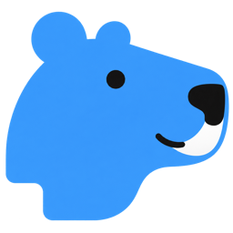

<p align="center">
  
</p>

<h1 align="center">Agenvas</h1>

<p align="center"><strong>English</strong> | <a href="README.zh-CN.md">简体中文</a> | <a href="README.ja.md">日本語</a> | <a href="README.ru.md">Русский</a></p>

<p align="center"><strong>A self-hosted AI creative canvas</strong><br />Text, images, video, audio, and agents in one workspace.</p>

<p align="center">Agenvas aims to bring the creative canvas experience to individuals at a lower cost, with affordable choices and no requirement for expensive subscriptions or top-tier models.</p>

<p align="center">
  <a href="#quick-start">Quick start</a> ·
  <a href="#supported-integrations">Integrations</a> ·
  <a href="#deployment-and-maintenance">Deployment</a> ·
  <a href="#local-development">Development</a> ·
  <a href="#feedback-and-contributing">Feedback &amp; contributing</a> ·
  <a href="LICENSE">MIT</a>
</p>

<p align="center">Author: <a href="https://x.com/Grayrepo">X / Twitter @Grayrepo</a> · Email: <a href="mailto:yoshioka8084806@gmail.com">yoshioka8084806@gmail.com</a></p>

<p align="center">
  <br />
  Scan to follow on WeChat
</p>

> Development build for a single self-hosting administrator. Data compatibility with future versions is not guaranteed.

## Features

| Feature | Description |
| --- | --- |
| Creative canvas | Drag, box-select, connect, auto-arrange, name/collapse groups, duplicate nodes or groups, undo/redo presentation edits within the current session, and upload local media |
| Multimodal generation | Run text, image, video, and audio cards with queues, cancellation, regeneration, and version history |
| Agent collaboration | Use director chat in the bottom-right corner to read and work with the current canvas, with persistent conversations and Skills; media proposals require user approval |
| MCP access | Keep the built-in director and expose 14 creative tools (including local media upload and intelligent voiceover synthesis) to external clients through user tokens; authorized media calls accept tasks without per-call paid approval |
| Reusable materials | Project resources, personal assets, prompt templates, visual styles, and mixed references |
| Character consistency | Project characters, multiple looks, image and voice references; preview and apply to shot drafts, track affected shots, and review results separately |
| Image tools | Annotate, crop, rotate, mirror, resize, extract depth, and use configured AI editing capabilities |
| Self-hosting | Model settings, local and OSS/COS/S3 storage, task and call records, and project manifest exports |

The interface supports Chinese, English, Russian, and Japanese.

## Supported integrations

These integrations are implemented in Agenvas. Available models, parameters, and input limits depend on administrator-published capabilities and your provider account.

### Models and workflows

| Provider / platform | Models / integration | Available functions |
| --- | --- | --- |
| OpenAI-compatible endpoints | Chat Completions API | Text generation, director chat, and tool calling |
| OpenAI | GPT Image 2 / Images API | Image generation, reference-image editing, masks, and transparent backgrounds |
| Google | Nano Banana 2 / Gemini Flash Image | Image generation and reference-image editing |
| Google | Veo 3.1 / Gemini Omni | Video generation; video editing and extension on supported profiles |
| Volcano Ark | Seedance 2.0 | Text-to-video, first/last frames, and mixed image/video/audio references |
| Volcano Ark | Seedream 5.0 Pro / Flash / Lite | Image generation; interactive editing and layer decomposition on supported profiles |
| MiniMax | Official H3 API | Text-to-video, first/last frames, and mixed references |
| Kling | Image, video, and Omni model profiles | Image/video generation, image expansion, Omni editing, and motion control by model |
| Alibaba Model Studio / Wan | Wan 2.7 images / Wan 3.0 videos | Image/video generation and multiple reference inputs |
| Volcano Engine | Seed Audio 1.0 | Audio generation and reference-audio inputs |
| ComfyUI | Self-hosted API workflows | Import, map, and publish image/video workflows and their parameters |
| RunningHub | V2 workflows / AI apps | Publish image/video/audio capabilities with mapped inputs, parameters, and outputs |
| AutoDL | Hosted ComfyUI video workflows | Discover or import supported video workflows and publish their input and resolution options |

### Storage and external clients

| Service / protocol | Use in Agenvas |
| --- | --- |
| Alibaba Cloud OSS | Media archiving and media relay |
| Tencent Cloud COS | Media archiving and media relay |
| Amazon S3 / S3-compatible object storage | Media archiving and media relay through configurable S3 endpoints |
| SMB2/3 / HTTPS WebDAV | Remote media archiving; media relay uses an object store |
| MCP-compatible clients | External agents connect to Agenvas through Streamable HTTP and user tokens to use canvas, text, and media tools |

## Quick start

### 1. Start with one command

Before using the command below, install and start **Docker Engine / Docker Desktop**, with **Docker Compose v2**. No Git, local build tools, GPU, `.env` file, or model key is needed to start and sign in.

For a new installation, paste this entire block into a **macOS / Linux** terminal:

```sh
mkdir agenvas && cd agenvas && \
  curl -fL https://raw.githubusercontent.com/grayrepo-byte/Agenvas/main/docker-compose.yml \
    -o docker-compose.yml && \
  docker compose up -d --wait
```

**Windows: one-command installation**

For a new installation, open CMD or PowerShell and paste the corresponding block. Choose one of the two options.

<details>
<summary><strong>CMD (Command Prompt)</strong></summary>

```cmd
mkdir agenvas && cd agenvas && curl.exe -fL https://raw.githubusercontent.com/grayrepo-byte/Agenvas/main/docker-compose.yml -o docker-compose.yml && docker compose up -d --wait
```

</details>

<details>
<summary><strong>PowerShell (Windows PowerShell 5.1 / PowerShell 7)</strong></summary>

```powershell
& {
  $ErrorActionPreference = 'Stop'
  New-Item -ItemType Directory -Path agenvas | Out-Null
  Set-Location agenvas
  Invoke-WebRequest -Uri 'https://raw.githubusercontent.com/grayrepo-byte/Agenvas/main/docker-compose.yml' -OutFile docker-compose.yml -UseBasicParsing
  docker compose up -d --wait
}
```

</details>

**Windows: install with an AI Agent**

You can also ask WorkBuddy or another AI Agent with local computer access to follow the Windows commands above. After installation, open **<http://127.0.0.1:8088/setup>** to create your administrator account.

These steps prepare an `agenvas` directory and Compose file, pull the images, and wait for all three services to become healthy. Keep this directory for future management. If you already have the Compose file, run `docker compose up -d --wait` in its directory.

Database and encryption secrets are generated and saved automatically on first start. First-time image downloads may take a few minutes.

### 2. Create an administrator

Open **<http://127.0.0.1:8088/setup>** locally, or `http://<server-ip>:8088/setup` from another device. Choose an administrator username and password, then sign in. Complete setup on a controlled network before exposing the service to the internet.

### 3. Configure models and create

- **Text and Agent**: Add an OpenAI-compatible endpoint, model ID, and API key under settings → model settings. An administrator must run the tool-calling diagnostic before using an Agent.
- **Images, video, and audio**: Create connections, publish capabilities, and choose default models in media settings. The default deployment requires real model configuration before generating media.
- **External agents / MCP**: Create a user token under system settings → account security. Connect a Streamable HTTP client to your site’s `/mcp` endpoint (locally, `http://127.0.0.1:8088/mcp`) and configure `Authorization: Bearer <token>` in the client.

For **Ollama and other local OpenAI-compatible servers**, follow the [local model connection guide](docs/ollama-local.md). HTTP needs an explicit deployment allowlist for the exact host and port; `127.0.0.1` inside Docker refers to the container. Use a placeholder of at least eight characters, such as `ollama-local`, for a server that ignores API keys. Set both the serving model's context and the [Director Settings budget](docs/agent-context-safety.md) to compatible values; passing the tool diagnostic does not prove that a full Agent request fits.

Create a project and use the canvas context menu to add cards or upload media. Select a model, enter a prompt and references, check the estimated cost, and run. Preview, select, or regenerate results. Open director chat in the bottom-right corner to use a project assistant that reads and works with the current canvas on demand. Select nodes to highlight the focus of your request. Map required Skill inputs to exact versions of canvas content, then approve or reject media proposals as a batch in the conversation. No Agent canvas node or persistent material binding is needed.

The media relay can be enabled separately for OpenAI-compatible LLM image inputs and OpenAI Images references/masks; when disabled, the original transfer method is retained. Local video references for Seedance and MiniMax H3 require a publicly accessible relay. In storage settings, add an OSS, COS, or S3 connection with a publicly reachable HTTPS endpoint, then select it for media relay. Permanent media archiving can remain local.

> UNKNOWN results require an explicit retry, which may incur duplicate costs. Cancellation does not guarantee that an external service stops or refunds charges. Project manifests contain data and media metadata; they do not replace database and media file backups.

## Deployment and maintenance

Run the following commands from the directory containing `docker-compose.yml` (created as `agenvas` above):

| Action | Command |
| --- | --- |
| Start / update to the configured image version | `docker compose up -d --wait` |
| Stop while keeping data | `docker compose down` |
| View service status | `docker compose ps --format "table {{.Service}}\t{{.Status}}\t{{.Ports}}"` |
| View recent startup logs | `docker compose logs --tail=100 server postgres` |

> Back up the database, media, configuration, and encryption secrets before updating. **Do not run `docker compose down -v`**: it deletes data and secrets.

Third-party prompt synchronization is **off by default** for both new and upgraded installations. In third-party template source management, enable automatic synchronization and save to refresh enabled sources every 24 hours. Sources fetch public content from `raw.githubusercontent.com` and `imagepromptgallery.com`. Disabling stops new scheduled source claims; a download already accepted may finish. Existing source settings and cached prompts are retained, and explicit manual synchronization remains available. The operator can additionally disable scheduling with `AGENVAS_PROMPT_SYNC_ENABLED: "false"` in the server Compose environment. See [prompt sources and network access](docs/prompt-sources.md).

<details>
<summary><strong>Ports, image versions, and public deployment</strong></summary>

- The default `docker-compose.yml` publishes only Web `8088` on `0.0.0.0`, allowing access through the server IP. API `8080` and PostgreSQL `5432` use the internal container network and are not published to the host. Source and Mock Compose files retain all three ports on loopback for development. If the Web port is in use, change the host port in `ports`.
- The default file pulls `docker.io/grayrepo/agenvas-server:latest`, `docker.io/grayrepo/agenvas-web:latest`, and the official `postgres:17.11-alpine` image. Application images support amd64 / arm64; no local compilation is required.
- Application images are pulled on every `up`. To pin a version, replace `latest` with a published version, commit tag, or digest.
- Each Compose file includes environment settings, ports, volumes, health checks, and resource limits; edit it directly without additional configuration files.
- Public deployment requires HTTPS, a reverse proxy, and `AGENVAS_SECURE_COOKIES: "true"` in Compose.
- For source builds, update the checkout and run `./deploy/update-local.sh`; stop with `docker compose -f docker-compose.local.yml down`.

</details>

<details>
<summary><strong>Automatic secrets, administrator initialization, and recovery</strong></summary>

The database permanently records successful initialization: only one concurrent request succeeds; later requests return `409 SETUP_ALREADY_COMPLETED`. Restarts, disabling, or deleting the account never reopen setup. Failed initialization rolls back and can be retried. Complete setup on a controlled network before exposing a public reverse proxy.

The database password and credential encryption key are configured automatically. Their files are under `/run/agenvas/credentials/installation/` in the server container; ordinary use requires neither reading nor filling them in:

| Variable | Generated value | File |
| --- | --- | --- |
| `AGENVAS_DB_PASSWORD` | 32 random bytes encoded as a 64-character hexadecimal password | `database-password` |
| `AGENVAS_CREDENTIAL_MASTER_KEY` | 32 random bytes encoded as Base64 | `credential-master-key` |

To view the database password, run this command from the directory containing the Compose file while the PostgreSQL container is running:

```sh
docker compose exec -u 0 postgres cat /run/agenvas/credentials/installation/database-password
```

The service name is `postgres`. If you started with `-f` or `-p`, use the same options when reading the password. For example, for a source build:

```sh
docker compose -f docker-compose.local.yml exec -u 0 postgres cat /run/agenvas/credentials/installation/database-password
```

If you see `no configuration file provided: not found`, switch to the directory containing the Compose file or use `-f` to specify its correct path.

Values are never written into Compose, Git, or startup logs. Encrypt and escrow `credentials-data` separately when backing up. Avoid `down -v`, which deletes data and secrets. Existing databases must restore this volume or import the original database password and encryption key through a private Compose configuration outside the repository. Startup stops if they are missing, to avoid making existing credentials unreadable.

</details>

<details>
<summary><strong>Startup troubleshooting</strong></summary>

| Symptom | Next step |
| --- | --- |
| Docker cannot connect / Compose command unavailable | Start Docker Desktop or Docker Engine and check `docker compose version` |
| The `agenvas` directory already exists | For an existing installation, enter it and run `docker compose up -d --wait`; for a new download, choose an unused directory name |
| Compose download fails | Check access to `raw.githubusercontent.com`; you can also manually download [docker-compose.yml](docker-compose.yml) |
| `manifest unknown` / image unavailable | Check Docker Hub access and published tags; if no release is available, use [container source builds](#container-source-builds) |
| Port already in use | Edit the host port in `ports`, then start again; if you change `8088`, use the new port in the browser |
| Health checks fail | Inspect startup logs with the command above, fix the reported issue, and run the start command again |

</details>

## Local development

| Layer | Stack |
| --- | --- |
| Frontend | Vite · React · TypeScript · React Flow · TanStack Query · Zustand |
| Backend | Java 21 · Spring Boot · Spring AI · jOOQ |
| Data and deployment | PostgreSQL · Flyway · Docker Compose · REST / SSE |

Toolchain: JDK 21, Node 24 LTS (24.12+), and pnpm 12.5.1.

### Container source builds

From the repository root, compile server and web from the current checkout and start all three services; PostgreSQL uses the official fixed-version image:

```sh
docker compose -f docker-compose.local.yml up -d --build --wait
```

Alternatively, `./deploy/update-local.sh` builds images before updating containers and waiting for health checks, reporting build and update times separately. It reuses base images by default; use `./deploy/update-local.sh --pull` to refresh them explicitly. Use `./deploy/update-local.sh server` or `./deploy/update-local.sh web` for changes to one application (build both on the first deployment). Source Compose builds retain downloaded packages in a separate BuildKit Maven cache across `pom.xml` changes; a first build or Docker cache cleanup still requires downloads. The host's `~/.m2` is not automatically shared with the build container. The backend runs `package -Dmaven.test.skip=true`, skipping test compilation and execution without automatically running `mvn verify`; run full tests manually or through CI. The final table shows only container names, services, status, and ports. Source builds need no Docker Hub login. Text and media still default to `configured`. The existing `deploy/compose.yaml` uses the same source build configuration.

Image deployment and source builds both default to the `agenvas` project and retain the same database, media, and credential volumes. Back up data and check version compatibility before switching. To run independent environments simultaneously, use distinct project names with `-p` and override the ports.

### Mock environment

Start directly; the database password and encryption key are generated automatically, with no external model accounts:

```sh
docker compose -f deploy/compose.dev.yaml up -d --build --wait
```

Text and media use Mock. Images, video, and audio are synthetic demo materials, not real model output. Use the same setup URL to create your account directly. Stop with `down` using the same Compose file.

Default deployment and Mock use separate data volumes but share the default Web port. Set distinct ports to run both simultaneously.

<details>
<summary><strong>Run from source</strong></summary>

Frontend (separate terminal):

```sh
cd frontend
corepack pnpm install --frozen-lockfile
corepack pnpm api:generate
corepack pnpm dev
```

Backend (separate terminal; configure PostgreSQL and environment variables first):

```sh
cd backend
./mvnw spring-boot:run
```

For a standalone JVM, provide `AGENVAS_DB_URL`, `AGENVAS_DB_USER`, and `AGENVAS_DB_PASSWORD`; `.env.example` lists these variables but is not automatically loaded. Automatic installation secrets apply to container entrypoints. Source execution defaults to Mock. Media processing requires FFmpeg / FFprobe.

The director supports token-budgeted context compaction and durable long tasks, with a default 24-hour transient model recovery window. Set context, handoff, and retry budgets in the administrator’s Director settings screen; changes need no restart.

Vite runs on port `5173` and proxies `/api` to `localhost:8080`.

</details>

## Feedback and contributing

Report bugs and suggest improvements through [Issues](https://github.com/grayrepo-byte/Agenvas/issues), including your version and steps to reproduce. Contributions through [pull requests](https://github.com/grayrepo-byte/Agenvas/pulls) are welcome; read [AGENTS.md](AGENTS.md) before changing code and run the relevant checks. For security issues, follow the [security policy](SECURITY.md).

```text
frontend/       Pages and canvas interaction
backend/        Business APIs, Agent Runtime, and task execution
contracts/      Authoritative OpenAPI and content schemas
configs/        Agent, Skill, and trusted media workflow configuration
deploy/         Compose, Nginx, and container builds
docs/           Specifications, designs, and development documentation
```

## Open-source acknowledgements

Agenvas's built-in short-drama creation Skills come from [zenstory-ai/drama-skills](https://github.com/zenstory-ai/drama-skills). We thank the project's authors and contributors for sharing their creative skills and workflows as open source.

Video creation and prompting methods also draw on [MiniMax-H3/skills](https://github.com/MiniMax-AI/MiniMax-H3/tree/main/skills), adapted to canvas tools and the media approval workflow. See the third-party license terms below.

## License

Licensed under the [MIT License](LICENSE). Third-party dependencies, model weights, workflows, and components such as FFmpeg retain their own licenses.

The original materials and adaptations in the built-in [MiniMax H3 Skill collection](backend/src/main/resources/builtin-skills/minimax-h3/manifest.json) are governed by the [MiniMax H3 Community License](backend/src/main/resources/builtin-skills/minimax-h3/LICENSE), which includes territorial, commercial-use, and redistribution conditions; they are not relicensed under MIT. See [NOTICE](backend/src/main/resources/builtin-skills/minimax-h3/NOTICE) for sources and adaptation details. The original Drama Skills retain their [MIT license](backend/src/main/resources/builtin-skills/drama-skills/LICENSE).
