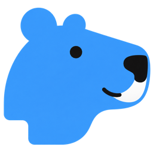

<p align="center">
  
</p>

<h1 align="center">Agenvas</h1>

<p align="center"><a href="README.md">English</a> | <a href="README.zh-CN.md">简体中文</a> | <a href="README.ja.md">日本語</a> | <strong>Русский</strong></p>

<p align="center"><strong>Творческий холст с ИИ на собственном сервере</strong><br />Текст, изображения, видео, аудио и агенты в одном рабочем пространстве.</p>

<p align="center">Agenvas стремится сделать творческий холст доступным для индивидуальных пользователей с минимальными затратами, сохраняя выбор недорогих решений без обязательных дорогих подписок и самых мощных моделей.</p>

<p align="center">
  <a href="#быстрый-старт">Быстрый старт</a> ·
  <a href="#поддерживаемые-интеграции">Интеграции</a> ·
  <a href="#развёртывание-и-обслуживание">Развёртывание</a> ·
  <a href="#локальная-разработка">Разработка</a> ·
  <a href="#обратная-связь-и-участие-в-проекте">Обратная связь и участие</a> ·
  <a href="LICENSE">MIT</a>
</p>

<p align="center">Автор: <a href="https://x.com/Grayrepo">X / Twitter @Grayrepo</a> · Почта: <a href="mailto:yoshioka8084806@gmail.com">yoshioka8084806@gmail.com</a></p>

<p align="center">
  <br />
  Отсканируйте код, чтобы подписаться в WeChat
</p>

> Это версия для разработки, рассчитанная на самостоятельное размещение с одним администратором. Совместимость данных с будущими версиями не гарантируется.

## Возможности

| Возможность | Описание |
| --- | --- |
| Творческий холст | Перетаскивание, выделение рамкой, связи, автоматическое упорядочивание, именование и сворачивание групп, копирование узлов и целых групп, отмена и повтор изменений представления в текущем сеансе, загрузка локальных медиафайлов |
| Мультимодальная генерация | Запуск текстовых, графических, видео- и аудиокарточек с очередью, отменой, повторной генерацией и историей версий |
| Работа с агентом | Чат режиссёра в правом нижнем углу по запросу читает и изменяет текущий холст; поддерживает постоянные диалоги и Skills. Предложения по генерации медиа выполняются после одобрения пользователя |
| Подключение по MCP | Встроенный режиссёр сохраняется, а внешние клиенты получают доступ к 13 творческим инструментам через пользовательские токены, включая интеллектуальный синтез озвучки. Разрешённые вызовы генерации медиа принимаются без отдельного одобрения оплаты каждого вызова |
| Повторное использование материалов | Ресурсы проекта, личная библиотека ассетов, шаблоны промптов, медиастили и смешанные референсы |
| Согласованность персонажей | Персонажи проекта, несколько образов, графические и голосовые референсы. Предпросмотр и применение к черновикам кадров, отслеживание влияния изменений и отдельная проверка результатов |
| Обработка изображений | Аннотации, обрезка, поворот, отражение, увеличение, извлечение глубины и ИИ-редактирование в пределах настроенных возможностей |
| Управление сервером | Настройка моделей, локальное хранилище и OSS/COS/S3, записи задач и вызовов, экспорт манифестов проектов |

Интерфейс поддерживает китайский, английский, русский и японский языки.

## Поддерживаемые интеграции

Эти интеграции реализованы в Agenvas. Доступные модели, параметры и ограничения входных данных зависят от возможностей, опубликованных администратором, и вашей учётной записи у провайдера.

### Модели и рабочие процессы

| Провайдер / платформа | Модели / интеграция | Доступные функции |
| --- | --- | --- |
| OpenAI-совместимые адреса | Chat Completions API | Генерация текста, чат режиссёра и вызов инструментов |
| OpenAI | GPT Image 2 / Images API | Генерация изображений, редактирование по референсам, маски и прозрачный фон |
| Google | Nano Banana 2 / Gemini Flash Image | Генерация изображений и редактирование по референсам |
| Google | Veo 3.1 / Gemini Omni | Генерация видео; редактирование и продление видео в поддерживаемых профилях |
| Volcano Ark | Seedance 2.0 | Видео по тексту, первый и последний кадры, смешанные референсы изображений, видео и аудио |
| Volcano Ark | Seedream 5.0 Pro / Flash / Lite | Генерация изображений; интерактивное редактирование и разложение на слои в поддерживаемых профилях |
| MiniMax | Официальный H3 API | Видео по тексту, первый и последний кадры, смешанные референсы |
| Kling | Профили моделей изображений, видео и Omni | Генерация изображений и видео, расширение изображений, редактирование Omni и управление движением в зависимости от модели |
| Alibaba Model Studio / Wan | Изображения Wan 2.7 / видео Wan 3.0 | Генерация изображений и видео с несколькими референсами |
| Volcano Engine | Seed Audio 1.0 | Генерация аудио и входные аудиореференсы |
| ComfyUI | Самостоятельно размещённые API-процессы | Импорт, сопоставление и публикация процессов генерации изображений и видео с их параметрами |
| RunningHub | Процессы V2 / AI-приложения | Публикация возможностей генерации изображений, видео и аудио с сопоставленными входами, параметрами и выходами |
| AutoDL | Размещённые видеопроцессы ComfyUI | Обнаружение или импорт поддерживаемых видеопроцессов и публикация их входных параметров и вариантов разрешения |

### Хранилища и внешние клиенты

| Сервис / протокол | Использование в Agenvas |
| --- | --- |
| Alibaba Cloud OSS | Архивирование и ретрансляция медиафайлов |
| Tencent Cloud COS | Архивирование и ретрансляция медиафайлов |
| Amazon S3 / S3-совместимое объектное хранилище | Архивирование и ретрансляция медиафайлов через настраиваемые адреса S3 |
| SMB2/3 / HTTPS WebDAV | Удалённое архивирование медиафайлов; для ретрансляции используется объектное хранилище |
| MCP-совместимые клиенты | Внешние агенты подключаются к Agenvas через Streamable HTTP с пользовательскими токенами и используют инструменты холста, текста и медиа |

## Быстрый старт

### 1. Запуск командой

Перед выполнением команд установите и запустите **Docker Engine / Docker Desktop** с **Docker Compose v2**. Для запуска и входа не нужны Git, локальные инструменты сборки, GPU, файл `.env` или ключ модели.

Для новой установки вставьте весь блок в терминал **macOS / Linux**:

```sh
mkdir agenvas && cd agenvas && \
  curl -fL https://raw.githubusercontent.com/grayrepo-byte/Agenvas/main/docker-compose.yml \
    -o docker-compose.yml && \
  docker compose up -d --wait
```

**Windows: установка командой**

Для новой установки откройте CMD или PowerShell и вставьте соответствующий блок целиком. Выберите один из двух вариантов.

<details>
<summary><strong>CMD (командная строка)</strong></summary>

```cmd
mkdir agenvas && cd agenvas && curl.exe -fL https://raw.githubusercontent.com/grayrepo-byte/Agenvas/main/docker-compose.yml -o docker-compose.yml && docker compose up -d --wait
```

</details>

<details>
<summary><strong>PowerShell (Windows PowerShell 5.1 / PowerShell 7)</strong></summary>

```powershell
& {
  $ErrorActionPreference = 'Stop'
  New-Item -ItemType Directory -Path agenvas | Out-Null
  Set-Location agenvas
  Invoke-WebRequest -Uri 'https://raw.githubusercontent.com/grayrepo-byte/Agenvas/main/docker-compose.yml' -OutFile docker-compose.yml -UseBasicParsing
  docker compose up -d --wait
}
```

</details>

**Windows: установка с помощью ИИ-агента**

Можно также попросить WorkBuddy или другой ИИ-агент с доступом к компьютеру выполнить приведённые выше команды для Windows. После установки откройте **<http://127.0.0.1:8088/setup>** и создайте учётную запись администратора.

Эти команды создают каталог `agenvas` и файл Compose, загружают образы и ожидают готовности всех трёх сервисов. Сохраните каталог: дальнейшее управление выполняется из него. Если файл Compose уже есть, выполните `docker compose up -d --wait` в его каталоге.

Пароль базы данных и ключ шифрования учётных данных автоматически создаются при первом запуске и сохраняются постоянно. Вводить их вручную не требуется. Первая загрузка образов может занять несколько минут.

### 2. Создание администратора

На локальном компьютере откройте **<http://127.0.0.1:8088/setup>**, с другого устройства — `http://<server-ip>:8088/setup`. Задайте имя и пароль администратора, создайте учётную запись и войдите. Завершите первоначальную настройку в контролируемой сети до открытия доступа из интернета.

### 3. Настройка моделей и начало работы

- **Текст и агент**: в разделе «Настройки → Настройки моделей» добавьте OpenAI-совместимый адрес, ID модели и ключ API. Перед использованием агента администратор должен выполнить диагностику вызова инструментов.
- **Изображения, видео и аудио**: в настройках медиа создайте подключения, опубликуйте возможности и выберите модели по умолчанию. Для генерации медиа в обычной установке сначала нужно настроить реальные модели.
- **Внешние агенты / MCP**: создайте пользовательский токен в разделе «Системные настройки → Безопасность учётной записи». Подключите клиент Streamable HTTP к адресу `/mcp` вашего сайта (локально — `http://127.0.0.1:8088/mcp`) и задайте в клиенте `Authorization: Bearer <token>`.

Для **Ollama и других локальных OpenAI-совместимых серверов** используйте [руководство по подключению](docs/ollama-local.md). HTTP требует явного разрешения конкретного хоста и порта в настройках развёртывания. В Docker адрес `127.0.0.1` указывает на сам контейнер. Если сервер игнорирует ключ API, укажите значение длиной от восьми символов, например `ollama-local`. Контекст сервера и [бюджет в настройках режиссёра](docs/agent-context-safety.md) настраиваются отдельно. Успешная диагностика инструментов не подтверждает, что полный запрос агента помещается в контекст.

В настройках моделей и ComfyUI можно явно запустить поиск стандартного сервиса на хосте и выбрать разрешённый адрес для формы. Ручная настройка остаётся доступной. [Область поиска и ограничения платформ](docs/local-service-discovery.md) описаны отдельно.

Создайте проект и добавьте карточки или загрузите материалы через контекстное меню холста. Выберите модель, укажите промпт и референсы, проверьте примерную стоимость и запустите задачу. Готовые результаты можно просмотреть, выбрать или сгенерировать заново. Чат режиссёра в правом нижнем углу открывает помощника проекта, который по запросу читает и изменяет текущий холст. Выделите узлы, чтобы обозначить основную задачу. Обязательные входные данные Skill явно выбираются из содержимого холста с фиксацией точных версий. Предложения по генерации медиа можно одобрять или отклонять вместе в диалоге. Добавлять узел агента или привязывать материалы не требуется.

Медиаретранслятор можно отдельно включить для изображений на входе OpenAI-совместимых LLM и для референсов/масок OpenAI Images; при отключении сохраняется исходный способ передачи. Для локальных видеореференсов Seedance и MiniMax H3 нужен ретранслятор, доступный из интернета. В настройках хранилища добавьте подключение OSS, COS или S3 с доступным из интернета HTTPS-адресом и выберите его для ретрансляции медиа. Постоянный архив медиафайлов может оставаться локальным.

> Неизвестный результат (UNKNOWN) требует явной повторной попытки, которая может привести к повторной оплате. Отмена не гарантирует остановку внешнего сервиса или возврат денег. Манифест проекта содержит данные и метаданные материалов, но не заменяет резервную копию базы данных и медиафайлов.

## Развёртывание и обслуживание

Выполняйте команды в каталоге с `docker-compose.yml` (каталог `agenvas`, созданный выше):

| Действие | Команда |
| --- | --- |
| Запуск / обновление до версии образа из конфигурации | `docker compose up -d --wait` |
| Остановка с сохранением данных | `docker compose down` |
| Проверка состояния сервисов | `docker compose ps --format "table {{.Service}}\t{{.Status}}\t{{.Ports}}"` |
| Последние журналы запуска | `docker compose logs --tail=100 server postgres` |

> Перед обновлением сохраните резервные копии базы данных, медиафайлов, настроек и ключей шифрования. **Не выполняйте `docker compose down -v`**: эта команда удаляет данные и ключи.

Синхронизация сторонних промптов **по умолчанию отключена** как при новой установке, так и после обновления. В управлении источниками сторонних шаблонов включите автоматическую синхронизацию и сохраните настройку: выбранные источники будут обновляться каждые 24 часа с `raw.githubusercontent.com` и `imagepromptgallery.com`. Отключение прекращает приём новых загрузок по расписанию; уже начатая загрузка может завершиться. Настройки источников и кэш сохраняются, ручная синхронизация остаётся доступной. Оператор также может остановить расписание через `AGENVAS_PROMPT_SYNC_ENABLED: "false"` в окружении server в Compose. Подробнее — в [описании источников и сетевого доступа](docs/prompt-sources.md).

<details>
<summary><strong>Порты, версии образов и публикация в интернете</strong></summary>

- Стандартный `docker-compose.yml` публикует только Web `8088` на `0.0.0.0`, позволяя подключаться по IP сервера. API `8080` и PostgreSQL `5432` работают во внутренней сети контейнеров и не публикуются на хосте. Compose для сборки из исходников и Mock сохраняют все три порта на loopback для разработки. Если веб-порт занят, измените порт хоста в `ports`.
- По умолчанию загружаются `docker.io/grayrepo/agenvas-server:latest`, `docker.io/grayrepo/agenvas-web:latest` и официальный `postgres:17.11-alpine`. Образы приложения поддерживают amd64 / arm64; локальная компиляция не нужна.
- Образы приложения загружаются при каждом `up`. Чтобы закрепить версию, замените `latest` на опубликованную версию, тег коммита или digest.
- Каждый файл Compose полностью задаёт окружение, порты, тома, проверки готовности и ограничения ресурсов. Редактируйте выбранный файл напрямую: дополнительные файлы конфигурации не нужны.
- Для доступа из интернета настройте HTTPS, обратный прокси и значение `"true"` для `AGENVAS_SECURE_COOKIES` в Compose.
- Для сборки из исходников после обновления кода выполните `./deploy/update-local.sh`; для остановки — `docker compose -f docker-compose.local.yml down`.

</details>

<details>
<summary><strong>Автоматические ключи, первоначальная настройка и восстановление</strong></summary>

База данных постоянно хранит признак завершённой первоначальной настройки. Из параллельных запросов успешен только один; последующие получают `409 SETUP_ALREADY_COMPLETED`. Перезапуск, отключение или удаление администратора не открывают настройку заново. Неудачная настройка откатывается и допускает повторную попытку. Завершите её в контролируемой сети до открытия публичного обратного прокси.

Пароль базы данных и главный ключ шифрования учётных данных настраиваются автоматически. Файлы находятся в `/run/agenvas/credentials/installation/` контейнера server; для обычного использования читать или вводить их не нужно.

| Переменная | Создаваемое значение | Файл |
| --- | --- | --- |
| `AGENVAS_DB_PASSWORD` | 32 случайных байта в виде шестнадцатеричного пароля длиной 64 символа | `database-password` |
| `AGENVAS_CREDENTIAL_MASTER_KEY` | 32 случайных байта ключа в кодировке Base64 | `credential-master-key` |

Если нужно посмотреть пароль базы данных, выполните команду из каталога с файлом Compose при работающем контейнере `postgres`:

```sh
docker compose exec -u 0 postgres cat /run/agenvas/credentials/installation/database-password
```

Имя сервиса — `postgres`. Если при запуске использовались `-f` или `-p`, укажите те же параметры. Пример для сборки из исходников:

```sh
docker compose -f docker-compose.local.yml exec -u 0 postgres cat /run/agenvas/credentials/installation/database-password
```

При ошибке `no configuration file provided: not found` перейдите в каталог с файлом Compose или задайте правильный путь через `-f`.

Ключи не записываются в Compose, Git или журналы запуска. При резервном копировании отдельно зашифруйте и сохраните `credentials-data`. Команда `down -v` удаляет данные и ключи. При переводе существующей базы данных на этот способ запуска сначала восстановите том с ключами либо передайте исходные пароль базы данных и главный ключ через непубличную конфигурацию Compose вне репозитория. Если они отсутствуют, запуск прекращается, чтобы не допустить потери доступа к зашифрованным учётным данным.

</details>

<details>
<summary><strong>Устранение проблем при запуске</strong></summary>

| Проблема | Действие |
| --- | --- |
| Нет соединения с Docker / недоступна команда Compose | Запустите Docker Desktop или Docker Engine и проверьте `docker compose version` |
| Каталог `agenvas` уже существует | Для существующей установки перейдите в него и выполните `docker compose up -d --wait`; для новой загрузки выберите свободное имя каталога |
| Не удаётся загрузить Compose | Проверьте доступ к `raw.githubusercontent.com` или загрузите [docker-compose.yml](docker-compose.yml) вручную |
| `manifest unknown` / образ недоступен | Проверьте доступ к Docker Hub и опубликованные теги; если готового релиза нет, используйте [сборку из исходников в контейнерах](#сборка-из-исходников-в-контейнерах) |
| Порт занят | Измените порт хоста в `ports` и запустите снова; при изменении `8088` укажите новый порт в браузере |
| Проверки готовности не проходят | Просмотрите журналы запуска командой выше, устраните причину и повторите запуск |

</details>

## Локальная разработка

| Уровень | Технологии |
| --- | --- |
| Фронтенд | Vite · React · TypeScript · React Flow · TanStack Query · Zustand |
| Бэкенд | Java 21 · Spring Boot · Spring AI · jOOQ |
| Данные и развёртывание | PostgreSQL · Flyway · Docker Compose · REST / SSE |

Инструменты: JDK 21, Node 24 LTS (24.12+), pnpm 12.5.1.

### Сборка из исходников в контейнерах

Из корня репозитория выполните команду для сборки текущих исходников server и web и запуска трёх сервисов. PostgreSQL использует официальный образ с фиксированной версией:

```sh
docker compose -f docker-compose.local.yml up -d --build --wait
```

Можно также использовать `./deploy/update-local.sh`: он сначала собирает образы, затем обновляет контейнеры и ждёт их готовности, отдельно показывая время сборки и обновления. По умолчанию базовые образы используются повторно; для явного обновления выполните `./deploy/update-local.sh --pull`. Если изменилось только одно приложение, используйте `./deploy/update-local.sh server` или `./deploy/update-local.sh web` (при первой установке соберите оба). Compose для исходников использует отдельный кеш BuildKit Maven: загруженные пакеты сохраняются даже при изменении `pom.xml`. Первая сборка и сборка после очистки кеша Docker требуют загрузки пакетов. Каталог `~/.m2` хоста не передаётся контейнеру автоматически. Бэкенд выполняет `package -Dmaven.test.skip=true`, пропуская компиляцию и запуск тестов; `mvn verify` автоматически не запускается. Полные тесты выполняйте при необходимости вручную или в CI. Итоговая таблица показывает только имена контейнеров, сервисы, состояние и порты. Для сборки из исходников вход в Docker Hub не нужен. Текст и медиа по-прежнему используют режим `configured`. Прежний `deploy/compose.yaml` использует ту же конфигурацию сборки.

Развёртывание готовых образов и сборка из исходников по умолчанию используют проект `agenvas` и общие тома базы данных, материалов и ключей. Перед переключением сделайте резервную копию и проверьте совместимость версий. Чтобы запустить независимые окружения одновременно, задайте разные имена проектов через `-p` и измените порты.

### Окружение Mock

Запускается напрямую; пароль базы данных и главный ключ также создаются автоматически. Учётные записи внешних моделей не нужны:

```sh
docker compose -f deploy/compose.dev.yaml up -d --build --wait
```

Текст и медиа работают в режиме Mock. Изображения, видео и аудио — синтетические демонстрационные материалы, а не результаты реальных моделей. Адрес и первоначальная настройка такие же, как выше. Для остановки используйте `down` с тем же файлом Compose.

Обычная установка и Mock используют отдельные тома данных, но один и тот же веб-порт по умолчанию. Для одновременного запуска задайте разные порты.

<details>
<summary><strong>Запуск из исходников</strong></summary>

Фронтенд (отдельный терминал):

```sh
cd frontend
corepack pnpm install --frozen-lockfile
corepack pnpm api:generate
corepack pnpm dev
```

Бэкенд (отдельный терминал; сначала настройте PostgreSQL и переменные окружения):

```sh
cd backend
./mvnw spring-boot:run
```

Для отдельной JVM задайте `AGENVAS_DB_URL`, `AGENVAS_DB_USER`, `AGENVAS_DB_PASSWORD`. Переменные перечислены в `.env.example`, но JVM не загружает этот файл автоматически. Автоматическое создание ключей работает только в точке входа контейнера. Запуск из исходников по умолчанию использует Mock. Для обработки медиа нужны FFmpeg / FFprobe.

Режиссёр автоматически уплотняет контекст в пределах бюджета токенов и поддерживает возобновление длительных задач с сохранённым состоянием. Временные ошибки модели по умолчанию допускают восстановление в течение 24 часов. Размер контекстного окна, параметры суммаризации и бюджет повторных попыток сохраняются в административном разделе настроек режиссёра без перезапуска.

Vite по умолчанию работает на порту `5173` и проксирует `/api` на `localhost:8080`.

</details>

## Обратная связь и участие в проекте

Сообщайте об ошибках и предлагайте улучшения через [Issues](https://github.com/grayrepo-byte/Agenvas/issues), указывая версию и шаги воспроизведения. Приветствуются [Pull Request](https://github.com/grayrepo-byte/Agenvas/pulls); перед изменением кода прочитайте [AGENTS.md](AGENTS.md) и выполните соответствующие проверки. О проблемах безопасности сообщайте согласно [политике безопасности](SECURITY.md).

```text
frontend/       Страницы интерфейса и взаимодействие с холстом
backend/        Бизнес-API, Agent Runtime и обработка задач
contracts/      Авторитетные OpenAPI и схемы содержимого
configs/        Настройки Agent, Skill и доверенных медиапроцессов
deploy/         Compose, Nginx и сборка контейнеров
docs/           Спецификации, проекты решений и документация разработки
```

## Благодарности проектам с открытым кодом

Встроенные в Agenvas Skills для создания коротких драм основаны на [zenstory-ai/drama-skills](https://github.com/zenstory-ai/drama-skills). Благодарим авторов и участников проекта за открытые творческие навыки и рабочие процессы.

Методы создания видео и подготовки промптов также опираются на [MiniMax-H3/skills](https://github.com/MiniMax-AI/MiniMax-H3/tree/main/skills) и адаптированы к инструментам холста и процессу одобрения медиа. Условия сторонних лицензий приведены ниже.

## Лицензия

Проект распространяется по [лицензии MIT](LICENSE). Сторонние зависимости, веса моделей, рабочие процессы и компоненты, такие как FFmpeg, сохраняют собственные лицензии.

Исходные материалы и адаптации во встроенной [коллекции MiniMax H3 Skills](backend/src/main/resources/builtin-skills/minimax-h3/manifest.json) регулируются [MiniMax H3 Community License](backend/src/main/resources/builtin-skills/minimax-h3/LICENSE), содержащей территориальные условия и ограничения коммерческого использования и распространения. Они не перелицензируются под MIT. Источники и сведения об адаптации указаны в [NOTICE](backend/src/main/resources/builtin-skills/minimax-h3/NOTICE). Исходные Drama Skills сохраняют [лицензию MIT](backend/src/main/resources/builtin-skills/drama-skills/LICENSE).
