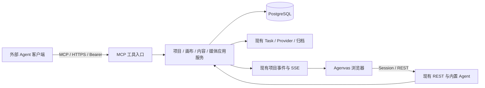

# MCP 附加接入实施计划

状态：代码已实施，按下述首版边界交付。保留现有 Agent，附加用户级 MCP，媒体生成不增加收费审批。实际验证与限制见[开发清单](DEVELOPMENT-CHECKLIST.md)，使用见[客户端指南](mcp-client-guide.md)。方向决策见 [ADR 0048](adr/0048-additive-mcp-access.md)。

## 1. 目标与首版边界

- 内置导演、聊天、AgentRun、LlmTurn、Skill、模型循环、现有媒体审批及结果续接全部保留。MCP 不创建第二个导演，不占用项目活动 Run 槽位。
- 在现有 Spring Boot 增加 `/mcp` 入口，外部客户端自行负责对话、模型、上下文和工具循环。Agenvas 只接收受认证的业务工具调用。
- 一份 MCP 凭据属于一个用户，可操作该用户当前有权访问的项目；不按项目签发凭据。每个项目工具显式携带 `projectId`，服务端逐次校验当前权限和资源归属。
- `run_media` 直接受理持久媒体 Task，不创建待审批事项，不要求再次确认费用。生成权限来自用户授予凭据的 `MEDIA_GENERATE` 能力，模型不能自行增加权限。
- 复用已有 Task、Provider、用量、归档、不可变版本、UNKNOWN 和画布事件。内置 Agent 的审批要求不因 MCP 改变。
- 首版交付一个实际外部客户端的完整闭环，不承诺所有 MCP 客户端兼容。已验证官方 Java SDK 2.0.0 的实际 HTTP 客户端逐一调用 12 工具，以及 MCP Inspector 2.12.0 完成文字与 Mock 图片闭环；Claude Code 2.1.296 通过环境变量 Bearer 健康连接。另有 `McpRealServiceIT` 对复用三方配置的隔离服务完成真实 GPT Image 2 兼容图片能力的 12 工具及单张生成验收；另以 Python HTTP JSON-RPC 客户端完成 AutoDL 视频适配器的 6 段同人物参考生成及 10 句 SeedAudio 配音，全部成功；拼接、字幕和混音由本地完成，成片通过普通 REST 上传回写。Claude 模型驱动对话和其他未列 Provider 未运行；视频仅做抽帧与解码检查，配音未听验。
- 首版不做 ACP、Agent Runner、OAuth 登录授权服务、外部聊天同步、完成后自动唤醒、上传工具、项目创建/删除、节点删除/复制、UNKNOWN 重试工具或 CreativeSkill 接入。既有对应功能继续工作。

## 2. 执行拓扑



MCP 是同一应用中的接入模块，不增加业务服务器、数据库、端口或持久卷。外部客户端不访问生产数据库、Provider 密钥或素材卷。浏览器继续从项目事件和查询投影得到画布变化。

采用现有 Spring AI 2.0.1 BOM 管理的 `spring-ai-starter-mcp-server-webmvc` 与官方 Java SDK 2.0.0，最高协商 `2025-11-25`，无状态 Streamable HTTP。关闭自动工具发现，由本项目显式注册白名单；不导出内置 Spring Tool Bean，不升级 Java 21、Boot 4 或 Jackson 3 基线，不引入预览依赖。

协议业务身份始终来自逐请求认证，不来自 MCP transport session。无论 SDK 是否维护连接状态，断线都不丢失已提交命令和媒体 Task。

## 3. 首批工具：12 个

通用约定：除 `list_projects` 外均必填 `projectId`；写工具另必填客户端生成的稳定 `commandId`。用户身份、凭据身份、来源、下游 Task 命令键由服务端注入。工具参数不得包含 Provider Key、任意执行 URL、脚本或“已批准”标记。

| 工具 | 权限 | 主要参数与返回 | 首版行为 |
| --- | --- | --- | --- |
| `list_projects` | `READ` | 分页、可选名称查询；项目 ID、名称、状态 | 只列当前用户有权访问的项目，不返回导演/模型配置 |
| `read_project_summary` | `READ` | `projectId`；项目名称、画幅及内容数量 | 使用独立安全投影，不复用包含 Run/Task 输入的全量快照 |
| `read_canvas` | `READ` | `offset/limit/includeDrafts`；节点目录、内容引用、布局 CAS、草稿 CAS | 默认元数据和草稿摘要；显式读取完整草稿，沿用已有分页上限 |
| `read_artifacts` | `READ` | 精确 `versionIds`；文字、媒体元数据、受控图片预览 | 每个引用必须属于指定项目；不返回内部文件路径或可复用签名下载 URL |
| `create_text` | `CONTENT_WRITE` | `title/text/placement?`；内容版本、节点及 CAS | 内容与节点同事务创建，响应丢失不重复放置 |
| `revise_artifact` | `CONTENT_WRITE` | 文字产物 ID、`expectedVersion`、新正文 | 仅追加文字版本，检查当前版本及节点锁定，不改归档媒体 |
| `manage_canvas_node` | `CONTENT_WRITE` | `canvasItemId/action/expectedVersion` 与动作字段 | 首批仅 `RENAME/MOVE/RESIZE`；内容与布局版本分开 |
| `create_media_node` | `CONTENT_WRITE` | `kind/title/placement?`；Artifact、CanvasItem、初始草稿版本 | IMAGE/VIDEO/AUDIO 空节点，不调用 Provider |
| `update_media_draft` | `CONTENT_WRITE` | 节点、`expectedDraftVersion/patch`；新草稿 | 复用提示词、能力、参数、模式、mentions、精确输入及引用连线规则，只保存草稿 |
| `list_media_capabilities` | `READ` | 媒体种类、分页；已发布能力和支持输入 | 安全能力目录，不包含连接地址、密钥、原始工作流 JSON |
| `run_media` | `MEDIA_GENERATE` | 节点、`expectedDraftVersion`；全部受理 Task、目标节点、固定输入摘要 | 直接受理，无收费审批；服务端由节点解析 Artifact，布局变化不使生成 CAS 失效 |
| `read_task_status` | `READ` | 同项目 `taskIds`；真实状态、错误、结果版本和来源摘要 | 查询不提交新任务；UNKNOWN 原样返回，不重做生成 |

`READ` 为基础权限；创建/修改草稿需要 `CONTENT_WRITE`，运行已存在的草稿需要 `MEDIA_GENERATE`。两种写权限分别校验，不能因能改提示词就自动取得生成权限。工具发现按权限过滤，工具执行仍重新校验。

读取范围采用用户当前项目权限，不创建一份模拟内置 Run 的冻结画布名单。读取媒体使用明确的内容版本；写入使用对象当前 CAS；媒体 Task 受理时固定草稿、能力、输入及费用快照。浏览器当前选择不自动成为外部客户端的输入，需要外部客户端明确指定节点。

首版文字和 JSON 结果执行现有长度/数量限制；图片通过已有受控预览管线返回 MCP image 内容。视频/音频先返回元数据与可引用的精确版本，不声称所有客户端可直接理解其字节。

## 4. 用户级鉴权

### 4.1 凭据与管理入口

采用可撤销 opaque Bearer 凭据。凭据归属用户，没有 `projectId` 或项目授权副本；项目权限跟随用户当前权限，在每次调用时重新判断。

- 使用安全随机数生成至少 256 bit secret，凭据格式含可公开标识与随机 secret。数据库只存 secret hash、展示提示、用户、名称、权限、到期/撤销时间、版本及安全使用元数据。
- 明文仅创建响应返回一次；前端仅短暂保存在该次展示组件内，不写浏览器持久存储。服务端不为重放创建响应而保存明文。
- 账号设置新增“外部 Agent / MCP 访问令牌”：列表、创建、一次展示/复制、撤销、无密钥连接示例。创建时选择 `READ`、`CONTENT_WRITE`、`MEDIA_GENERATE`，并设置有效期；建议默认 30 天，首版最长 90 天。
- 不设置每次收费确认、审批卡或额外费用授权页面。`MEDIA_GENERATE` 凭据可直接调用已发布能力；正常用量校验、能力限制和错误处理继续执行。
- 丢失创建响应时，用户可从列表撤销未取回的凭据并重新创建；不能通过查询接口找回 secret。

计划 REST：

| 方法与路径 | 认证 | 返回/约束 |
| --- | --- | --- |
| GET `/api/v1/account/mcp-tokens` | 网页 Session | 当前用户凭据的安全元数据 |
| POST `/api/v1/account/mcp-tokens` | 网页 Session + CSRF | 创建用户级凭据，secret 仅此次返回；`Cache-Control: no-store` |
| POST `/api/v1/account/mcp-tokens/{id}/revoke` | 网页 Session + CSRF | 仅本人凭据；幂等撤销并保留审计身份 |

MCP 凭据不能调用管理凭据的 REST，也不能借由工具枚举管理员配置。首版是手工 Bearer 接入，不宣称实现 OAuth 发现、授权和动态客户端注册；要求 OAuth 登录的客户端留待后续。

### 4.2 认证与授权链

精确 `/mcp` 使用优先的独立无状态 Spring Security 链，只接受 Bearer，拒绝 Cookie 作为替代认证，不创建网页 Session。仅 MCP 协议入口免 CSRF，现有网页/API 防护保留。MCP token 只作为凭据，不进入模型工具参数。

```text
Bearer → 有效凭据与用户 → 工具权限与参数白名单
       → 项目事务锁与当前权限 → 凭据行锁复核
       → 命令账本重放/预留 → 同项目对象与锁定/占用/CAS/额度
       → 业务、账本与事件同提交
```

写命令在短事务内再次锁定并核验凭据有效性。统一锁顺序为项目事务锁 → 凭据行锁 → 目标业务对象/命令账本；撤销只锁凭据，不反向取项目锁。已先取得授权锁的短事务可以提交；撤销成功返回后，后续写事务必须拒绝。撤销不回滚历史，也不取消已经受理的 Task。

恢复模式按工具语义区分读写：MCP 的读取也使用 HTTP POST，不能把现有 `RecoveryModeWriteGuard` 的 HTTP 方法判断直接套过来。归档项目拒绝写入；读取继续按既有项目规则处理。原生客户端不携带 Origin；首版拒绝带 Origin 的浏览器调用，不开放 CORS。HTTPS 与 Host 按部署反代处理。后端实际请求体上限 300 KiB，工具参数 256 KiB，Nginx 外层 2 MiB；每用户跨令牌共用 4 个在途请求，进程最多 64 个，超限返回 429 和 Retry-After。SDK 原始报文日志关闭，协议解析失败不回传正文片段。

## 5. 写命令、任务与来源

### 5.1 每条写命令一条账本

不新增外部 AgentRun、会话、长任务编排器或 begin/close 操作生命周期。每个 MCP 写调用是一条持久外部工具操作：

- 唯一键为 `(userId, commandId)`，摘要覆盖工具名、项目和完整规范化参数。相同键同参返回原结果；同键异工具、项目或参数返回冲突。
- 身份与权限检查先于结果重放；失效凭据或已失去项目权限不能读取历史结果。合法轮换的新凭据在仍具备权限时，可重放该用户原命令。
- 命令账本、内容/节点修改、Task 受理、输出关联与项目事件同事务提交。出错整体回滚；网络调用不进入事务。
- 已提交命令先查账，再检查新请求中的当前对象 CAS，保证响应丢失后原命令重放能取得原结果。
- 重试连接使用同一 `commandId`。新的 `commandId` 表示新的用户委托命令，不能用参数 hash 永久去重，也不承诺模型换键后仍能识别同一意图。

读取工具不需要模拟持久模型回合。保留现有 `ToolExecutionService` 对内置 `LlmTurn.RESPONDED` 的检查和 Run 账本；MCP 直接调用下层应用服务，只抽取实际需要共用的创作组合逻辑。

### 5.2 媒体生成

```text
create_media_node → update_media_draft → run_media
  → 本地事务固定输入并创建 Task → 立即返回所有 taskIds
  → 现有 Worker 提交/查询/归档 → SSE 更新画布
  → 外部客户端调用 read_task_status 读取结果
```

- 新增可信 `DirectMediaTaskService.runExternal(...)` 入口，复用 `run` 的受理内核，不调用 `runApproved`，不写任何媒体审批表。
- Task 的 `runId` 为空；Task 输入由服务端加入 `initiator=EXTERNAL_MCP`、凭据 ID、外部操作 ID。网页直连和内置 Agent 分别有明确来源；这些字段不接受模型填写。
- 审核所有把 `runId == null` 等同“浏览器点击”的查询、取消、重试和队列逻辑。MCP 是用户委托的直接生成；网页登录用户按已有直接任务规则管理它，来源标签仍应区分。
- 下游命令键使用服务端命名空间，如 `mcp:{operationId}:{outputIndex}`，不与网页或 Agent 命令混用。
- 同一命令重放返回它的原 Task。其他命令已占用节点时，MCP 返回 `CANVAS_ITEM_BUSY`；不能把已有其他 Task 当成本次受理成功。现有网页入口复用占用任务的行为可保留。
- 受理结果 DTO 返回批量生成的完整 Task/目标节点集合；不能仅返回现有 `run` 的主 Task 而遗漏其他收费输出。数量继续受已有能力和参数上限约束。
- 断线或凭据到期不取消已受理 Task。外部任务终态只更新任务、来源与画布，不创建 `AGENT_TURN` 或写入导演对话。
- UNKNOWN、下载/归档恢复、取消后晚到结果继续走现有规则。首版 MCP 不暴露 UNKNOWN 重试或取消工具；网页仍可按既有规则显式处理。
- 外部客户端不保持模型轮询循环。工具立即返回任务 ID，之后按用户指令或客户端策略查询；首版不承诺自动唤醒。

### 5.3 来源与数据变更

V30 新增以下表，未修改此前 V27–V29：

| 表/模型 | 用途与关键约束 |
| --- | --- |
| `mcp_access_token` | 用户级凭据；`user_id`、secret hash、权限、期限、撤销、版本；没有项目列 |
| `mcp_operation` | 一次已提交写命令；用户、凭据、项目、工具、命令键、参数 hash、安全结果、提交时间；唯一用户+命令键 |
| `mcp_operation_task` | 外部命令到全部受理 Task 的类型化关联和输出顺序；Task FK，防止只追踪主任务 |
| `mcp_operation_version` | 外部命令到文字/媒体内容版本的来源关联；版本 FK，媒体归档时从可信 Task 来源补齐 |

文字新增 `ArtifactVersion.CreatedByKind.EXTERNAL_TOOL`，同步枚举、数据库约束和 API 类型；不填写虚假 Run，不伪装导演产物。媒体结果仍为 `TASK`，通过 Task 和关联表记录 MCP 发起来源。原 USER/AGENT/TASK 数据不重写，旧 Agent 数据不清理。

不新增 MCP 审批、模型检查点或外部会话表。MCP 命令完成表示本地业务已提交；媒体成功与否以 Task 为准。

## 6. 模块与文件改动

| 模块/路径 | 计划改动 | 保留范围 |
| --- | --- | --- |
| 新 `backend/.../mcp/{api,application,domain,infrastructure}` | 用户凭据、逐请求上下文、12 工具、独立写账本及安全投影；按真实职责建类 | 不复制 Agent Runtime，不建立模型调度器 |
| `shared/security/SecurityConfiguration` 及恢复模式守卫 | 独立 Bearer 链、凭据管理复用网页认证；恢复模式增加工具语义入口 | 原 Session/CSRF/登录初始化 |
| `project/application` | 复用当前用户项目列表与项目鉴权，新增安全 summary 组合 | 唯一导演、活动 Run 槽和全量网页快照 |
| `canvas/application` | 原子创建/更新节点，复用草稿保存/换引用和事件；必要时抽取锁定/占用检查 | 网页编辑和原 Agent 工具行为 |
| `artifact/application`、`artifact/domain` | 外部文字创建/修订入口、精确内容读取、EXTERNAL_TOOL 来源和版本关联 | 不可变版本、资源默认/节点选用语义 |
| `task/application/DirectMediaTaskService` 与任务查询 | `runExternal`、完整受理集合、严格占用冲突、可信来源，安全状态投影 | `run`、`runApproved`、现有取消/UNKNOWN 规则 |
| `provider`、`usage`、`asset` | 复用已有能力/提交/费用/归档；归档时延续 MCP 来源关联 | Provider 协议和 Worker 租约不重做 |
| `event`、前端画布缓存 | 使用原项目事件刷新节点和 Task；来源字段如需显示则增量扩展契约 | 原 SSE 顺序、补发和内置聊天流 |
| 前端账号设置、安全页面 | 用户级令牌管理组件、状态、一次展示、连接示例；四语言及 shadcn | 不新增项目凭据页或 MCP 收费审批入口 |
| `contracts/openapi.yaml`、新 `contracts/mcp/tools.json` | OpenAPI 管凭据 REST/公共 DTO；MCP 文件管首批工具的输入/输出 Schema，服务端加载或生成注册信息，避免两份手写定义 | 现有 Agent API 保持行为，TS 通过命令生成 |
| Flyway、jOOQ | 新增表及来源枚举迁移，重新生成 jOOQ | 已发布迁移不改、旧数据保留 |
| `backend/pom.xml`、`application.yaml` | 使用当前 BOM 的稳定 MCP WebMVC 集成，显式注册工具；提供运维关闭开关 | 不升级 Java/Boot/AI 大版本，不要求外部 Agent 才能启动 |
| `deploy/nginx/nginx.conf`、Compose 检查 | 精确 `/mcp` 反代，透传认证/协议头、禁缓存；按传输配置 buffering/超时 | 不新增 Runner、端口或卷；配置变量变化同步四份 Compose |

当前 `llm` 中的 `AgentTurnWorker`、`ToolExecutionService`、`AgentMediaApprovalService`、`AgentMediaOutcomeService` 和聊天组件均非删除目标。直连文字生成、图片反推提示词、ChatGateway、Spring AI 和 Mock 同样保留。

HTTP 凭据 schema 拟新增 `McpTokenSummary/CreateRequest/CreatedResponse`；MCP 结果用安全 DTO，不直接序列化数据库实体、Task.input、Director、原模型响应或私有推理。

## 7. 实施顺序与验收

下表保留实施前的拆分与成本估算，代码已按该顺序完成；估算按熟悉项目的开发者及现有媒体能力计算，不是实测工期。最终验证范围见开发清单。

| 阶段 | 交付与退出条件 | 估算 |
| --- | --- | --- |
| A：用户鉴权与只读接入 | 锁定 SDK/revision/客户端；用户 Token 管理；`list_projects/read_project_summary/read_canvas/read_artifacts/list_media_capabilities`；真实客户端能连，只能读本人项目 | 2–3 人日 |
| B：文字与画布命令 | 外部写账本、来源迁移、文字读写、媒体节点/草稿、布局工具；命令重放、同键异参、CAS、撤销竞争和恢复模式检查通过 | 2–3 人日 |
| C：直接媒体闭环 | `run_media/read_task_status`；完整任务集合与来源；响应丢失重放不新增任务，UNKNOWN 不重提，结果可在画布看到 | 3–5 人日 |
| D：交付准备 | 契约/类型生成、Nginx/Compose、实际客户端/Mock 分列验证、内置 Agent 非回归和资料同步 | 2–4 人日 |

合计约 **9–15 人日**。首个“读画布、改文字、提交一个 Mock 图片任务”的纵向切片约 **4–6 人日**，包含在总估算内。真实 Provider 凭据/环境不可用时，记录未验证范围，不把 Mock 通过当成真实生成接通。

每阶段开始以当时工作区为准读取调用链，不把此前讨论中的“替换导演”“项目级凭据”“收费审批”带回实现。当前代码和词汇已将内置导演的画布操作范围描述为项目当前内容；旧 ADR 中冻结目录的历史段落不得被 MCP 重构反向写入内置行为。

专项验收：

- 鉴权：无 token/伪造/过期/撤销、跨用户项目/版本/Task、权限不足；Cookie 无旁路；读令牌不能写/生成，生成权限不能修改令牌。
- 事务：撤销与在途写入、同键并发、同键异项目/异参数、业务失败回滚、响应丢失后重放；账本和创建节点/Task 同提交。
- 共存：网页、内置 Run、MCP 修改同对象时按 CAS 冲突；布局不改变内容版本；MCP 不占活动 Run、不创建 LlmTurn、不污染导演历史及产物归属。
- 媒体：无审批直接受理；锁定/占用/草稿 CAS/能力限制；批量完整返回；断线后继续后台任务；UNKNOWN 和归档重试不重提；外部完成不续接内置 Agent。
- 内置回归：导演聊天/流式、Skill、原审批及结果续接、直连文字和反推提示词、原网页媒体运行继续工作。
- 部署：`/mcp` 返回协议响应而非 SPA HTML；反代头正确；默认 Mock 脱离外部模型及客户端仍可启动。

## 8. 计划使用的验证命令

以下是实际定向验证入口；结果见开发清单。数据库事务/并发/恢复使用真实 PostgreSQL，不运行全量测试作为开发基线。

```bash
# backend/：本次新增功能单元测试
./mvnw -Dtest=McpTokenServiceTest,McpBearerAuthenticationFilterTest,McpRequestLimitsFilterTest,McpToolPolicyTest,McpCommandSchemaTest,IdentityServiceTest,MessageCatalogTest test

# backend/：定向数据库/HTTP集成与内置功能回归
./mvnw -Pci-integration -Dit.test=McpTokenPostgresIT,McpToolsPostgresIT,McpDirectMediaPostgresIT,McpHttpPostgresIT,McpRecoveryModePostgresIT,McpDisabledPostgresIT,FlywayBaselinePostgresIT,IdentityPostgresIT,ResourceScopePostgresIT,RecoveryModePostgresIT,AgentMediaApprovalPostgresIT,MockAgentTurnPostgresIT,AgentStreamPostgresIT,SkillRunPostgresIT,AgentRunPostgresIT,AgentConversationPostgresIT,DirectTextGenerationPostgresIT,ImagePromptPostgresIT,TaskSubmissionUnknownPostgresIT,DirectMediaGenerationPlacementPostgresIT verify

# backend/：按 ADR 0012 配置一次性空 PostgreSQL 后执行，不连接生产数据库
./mvnw -Pjooq-codegen generate-sources

# frontend/：契约与定向组件验证
pnpm api:generate
pnpm exec vitest run src/features/settings/McpTokensSection.test.tsx src/features/canvas/AgentChatPanel.test.tsx src/features/canvas/ProjectWorkspacePage.test.tsx
pnpm typecheck
pnpm lint
pnpm build
pnpm test:agent-chat-layout
pnpm test:agent-workspace
pnpm test:mcp-settings

# 仓库根：部署配置
bash deploy/check-compose.sh
```

MCP 协议测试使用选定 revision 的实际发现/初始化、工具枚举和调用；HTTP 401/403、协议错误与业务 `isError` 结构分别验证，不能统一返回成功文本。实际客户端验收单列，记录客户端版本、工具 Schema、图片读取和直接媒体任务结果。

## 9. 升级与实施资料

只增加 MCP 数据和必要来源扩展，不迁移或删除内置 Agent 历史。数据库升级前备份；新枚举、迁移、后端及生成类型按同批部署处理。关闭 MCP 时拒绝新调用，已受理 Task 继续按原持久化链完成；旧版本回退若不认识新来源枚举，需要恢复对应备份或使用经验证的兼容版本，不能直接假定可回退。

实施时同步依赖基线、OpenAPI、MCP Schema、jOOQ、生成 TS、开发清单和部署说明。未实现/未验证条目保持未勾选。V30/jOOQ、生成 TypeScript、工具 Schema、账户 UI 和部署反代已同步；验证结论以开发清单为准。

外部依据（本次核查 2026-10-22）：

- [MCP 服务端能力](https://modelcontextprotocol.io/docs/learn/server-concepts)：工具、资源和 Prompt 的职责；首批只依赖工具。
- [Streamable HTTP 当前规范](https://modelcontextprotocol.io/specification/2026-07-28/basic/transports/streamable-http)与[较早稳定 revision](https://modelcontextprotocol.io/specification/2025-11-25/basic/transports)：不同 revision 的传输行为存在差异，实施以锁定 SDK/客户端共同支持版本为准。
- [官方 MCP Java SDK](https://github.com/modelcontextprotocol/java-sdk)：提供 Servlet/JSON 集成，Spring 集成由 Spring AI 承载；兼容性仍须在项目内验证。
- [Claude Code MCP 文档](https://code.claude.com/docs/en/mcp)：HTTP 和手工 Bearer header 接入示例；不等于本项目已经完成实际连接验收。
- [MCP 授权规范](https://modelcontextprotocol.io/specification/2026-07-28/basic/authorization)：OAuth 授权互操作要求；首版手工 token 不声明覆盖完整 OAuth 接入。
